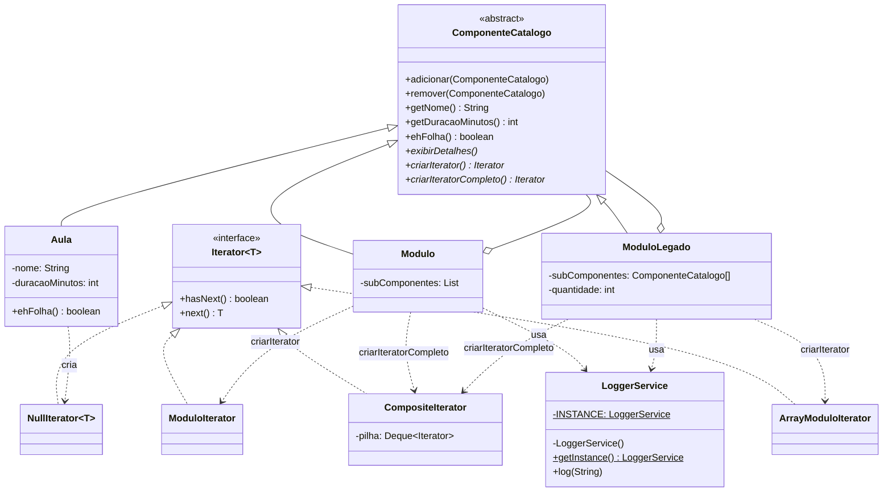

# Tutorial Guiado: Composição de Padrões (TechLearn Solutions)

Trabalho da disciplina de Padrões de Projeto (IFPE). A ideia da atividade é montar o catálogo de cursos de uma empresa fictícia, a TechLearn Solutions, usando três padrões juntos:

- Singleton no `LoggerService`, que é o único lugar do sistema que escreve log.
- Composite em `ComponenteCatalogo`, `Modulo`, `ModuloLegado` e `Aula`, para montar a árvore curso → módulos → aulas.
- Iterator em `Iterator`, `ModuloIterator`, `ArrayModuloIterator`, `CompositeIterator` e `NullIterator`, para percorrer essa árvore sem o cliente precisar saber como cada módulo guarda os filhos.

Segui o roteiro do professor e mantive os nomes de pacotes e classes dele. Depois fiz algumas melhorias, que explico no final.

## Estrutura de pastas

```text
.
├── README.md
└── src/
    └── techlearn/
        ├── Main.java
        ├── TesteSingletonThreads.java
        ├── TesteContratosAudit.java
        ├── logging/
        │   └── LoggerService.java
        ├── composite/
        │   ├── ComponenteCatalogo.java
        │   ├── Aula.java
        │   ├── Modulo.java
        │   └── ModuloLegado.java
        └── iterator/
            ├── Iterator.java
            ├── ModuloIterator.java
            ├── ArrayModuloIterator.java
            ├── CompositeIterator.java
            └── NullIterator.java
```

## Diagrama de classes



## Como compilar e executar

Precisa de um JDK 8 ou mais novo. Na raiz do projeto:

```bash
javac -encoding UTF-8 -d bin src/techlearn/*.java src/techlearn/logging/*.java src/techlearn/iterator/*.java src/techlearn/composite/*.java

java -cp bin techlearn.Main
java -cp bin techlearn.TesteSingletonThreads
java -cp bin techlearn.TesteContratosAudit
```

Usei `-encoding UTF-8` porque no Windows o `javac` às vezes lê os acentos errado. Se os acentos aparecerem estranhos no PowerShell, rode `[Console]::OutputEncoding = [Text.Encoding]::UTF8` antes e execute com `java "-Dstdout.encoding=UTF-8" -cp bin techlearn.Main`.

## Saída da execução

Saída real que deu aqui quando rodei `techlearn.Main` (JDK 21):

```text
[SISTEMA] Serviço de Logging Inicializado.
[2026-10-15 16:18:05] [LOG]: Iniciando montagem da estrutura de cursos...
[2026-10-15 16:18:05] [LOG]: Item 'Aula 1.1: Coesão e Acoplamento' adicionado ao módulo 'Módulo 1: Orientação a Objetos Avançada'.
[2026-10-15 16:18:05] [LOG]: Item 'Aula 1.2: Interfaces e Polimorfismo' adicionado ao módulo 'Módulo 1: Orientação a Objetos Avançada'.
[2026-10-15 16:18:05] [LOG]: Item 'Aula 2.1: Singleton na Prática' adicionado ao módulo 'Módulo 2: Padrões de Projeto (GoF)'.
[2026-10-15 16:18:05] [LOG]: Item 'Aula 2.2: Composite Hierárquico' adicionado ao módulo 'Módulo 2: Padrões de Projeto (GoF)'.
[2026-10-15 16:18:05] [LOG]: Item 'Aula 2.3: Iterator para Coleções' adicionado ao módulo 'Módulo 2: Padrões de Projeto (GoF)'.
[2026-10-15 16:18:05] [LOG]: Item 'Aula 2.4.1: Observer e Eventos' adicionado ao módulo 'Módulo 2.4: Padrões Comportamentais (legado)'.
[2026-10-15 16:18:05] [LOG]: Item 'Aula 2.4.2: Strategy no Dia a Dia' adicionado ao módulo 'Módulo 2.4: Padrões Comportamentais (legado)'.
[2026-10-15 16:18:05] [LOG]: Capacidade do módulo 'Módulo 2.4: Padrões Comportamentais (legado)' aumentada para 4.
[2026-10-15 16:18:05] [LOG]: Item 'Aula 2.4.3: Template Method' adicionado ao módulo 'Módulo 2.4: Padrões Comportamentais (legado)'.
[2026-10-15 16:18:05] [LOG]: Item 'Módulo 2.4: Padrões Comportamentais (legado)' adicionado ao módulo 'Módulo 2: Padrões de Projeto (GoF)'.
[2026-10-15 16:18:05] [LOG]: Item 'Módulo 1: Orientação a Objetos Avançada' adicionado ao módulo 'Engenharia de Software Moderna'.
[2026-10-15 16:18:05] [LOG]: Item 'Módulo 2: Padrões de Projeto (GoF)' adicionado ao módulo 'Engenharia de Software Moderna'.
[2026-10-15 16:18:05] [LOG]: Estrutura montada com sucesso. Exibindo detalhes da ementa:

[Módulo/Curso]: Engenharia de Software Moderna | Duração Total: 340 min
--------------------------------------------------

[Módulo/Curso]: Módulo 1: Orientação a Objetos Avançada | Duração Total: 105 min
--------------------------------------------------
  - Aula: Aula 1.1: Coesão e Acoplamento (45 min)
  - Aula: Aula 1.2: Interfaces e Polimorfismo (60 min)

[Módulo/Curso]: Módulo 2: Padrões de Projeto (GoF) | Duração Total: 235 min
--------------------------------------------------
  - Aula: Aula 2.1: Singleton na Prática (30 min)
  - Aula: Aula 2.2: Composite Hierárquico (50 min)
  - Aula: Aula 2.3: Iterator para Coleções (40 min)

[Módulo/Curso]: Módulo 2.4: Padrões Comportamentais (legado) | Duração Total: 115 min
--------------------------------------------------
  - Aula: Aula 2.4.1: Observer e Eventos (35 min)
  - Aula: Aula 2.4.2: Strategy no Dia a Dia (55 min)
  - Aula: Aula 2.4.3: Template Method (25 min)

==================================================
Varredura do Curso Principal via Iterator:
==================================================
[2026-10-15 16:18:05] [LOG]: Navegando no Item Raiz: Módulo 1: Orientação a Objetos Avançada | Duração acumulada: 105 min
[2026-10-15 16:18:05] [LOG]: Navegando no Item Raiz: Módulo 2: Padrões de Projeto (GoF) | Duração acumulada: 235 min

==================================================
Varredura Completa da Árvore via CompositeIterator:
==================================================
[2026-10-15 16:18:05] [LOG]: [Módulo] Módulo 1: Orientação a Objetos Avançada (105 min)
[2026-10-15 16:18:05] [LOG]: [Aula  ] Aula 1.1: Coesão e Acoplamento (45 min)
[2026-10-15 16:18:05] [LOG]: [Aula  ] Aula 1.2: Interfaces e Polimorfismo (60 min)
[2026-10-15 16:18:05] [LOG]: [Módulo] Módulo 2: Padrões de Projeto (GoF) (235 min)
[2026-10-15 16:18:05] [LOG]: [Aula  ] Aula 2.1: Singleton na Prática (30 min)
[2026-10-15 16:18:05] [LOG]: [Aula  ] Aula 2.2: Composite Hierárquico (50 min)
[2026-10-15 16:18:05] [LOG]: [Aula  ] Aula 2.3: Iterator para Coleções (40 min)
[2026-10-15 16:18:05] [LOG]: [Módulo] Módulo 2.4: Padrões Comportamentais (legado) (115 min)
[2026-10-15 16:18:05] [LOG]: [Aula  ] Aula 2.4.1: Observer e Eventos (35 min)
[2026-10-15 16:18:05] [LOG]: [Aula  ] Aula 2.4.2: Strategy no Dia a Dia (55 min)
[2026-10-15 16:18:05] [LOG]: [Aula  ] Aula 2.4.3: Template Method (25 min)

==================================================
Desafio Passo 5: Filtro de Conteúdo Curto (<= 45 min):
==================================================
[2026-10-15 16:18:05] [LOG]: Iniciando filtragem de aulas individuais com duração <= 45 min...
[2026-10-15 16:18:05] [LOG]: [FILTRO <= 45 min] Aula 1.1: Coesão e Acoplamento (45 min)
[2026-10-15 16:18:05] [LOG]: [FILTRO <= 45 min] Aula 2.1: Singleton na Prática (30 min)
[2026-10-15 16:18:05] [LOG]: [FILTRO <= 45 min] Aula 2.3: Iterator para Coleções (40 min)
[2026-10-15 16:18:05] [LOG]: [FILTRO <= 45 min] Aula 2.4.1: Observer e Eventos (35 min)
[2026-10-15 16:18:05] [LOG]: [FILTRO <= 45 min] Aula 2.4.3: Template Method (25 min)

==================================================
Teste do remover:
==================================================
[2026-10-15 16:18:05] [LOG]: Item 'Aula Extra: Revisão Geral' não encontrado no módulo 'Módulo 1: Orientação a Objetos Avançada'.
[2026-10-15 16:18:05] [LOG]: Item 'Aula Extra: Revisão Geral' adicionado ao módulo 'Módulo 1: Orientação a Objetos Avançada'.
[2026-10-15 16:18:05] [LOG]: Item 'Aula Extra: Revisão Geral' removido do módulo 'Módulo 1: Orientação a Objetos Avançada'.
[2026-10-15 16:18:05] [LOG]: Execução da atividade finalizada.
```

O que dá para conferir nessa saída:

- A mensagem de inicialização do logger aparece uma vez só, mesmo com o `getInstance()` sendo chamado em vários lugares.
- A duração total (340 min) é a soma de tudo, calculada pelo próprio Composite (105 + 235, e os 235 já incluem os 115 do módulo 2.4).
- O filtro achou as aulas curtas em todos os níveis, inclusive as duas do módulo legado, que guarda os filhos em array.

E a saída do `techlearn.TesteSingletonThreads`:

```text
Disparando 20 threads ao mesmo tempo...
[SISTEMA] Serviço de Logging Inicializado.
Referências coletadas: 20
Identidade da primeira instância: 2001049719
Todas as threads receberam o mesmo objeto? SIM
```

Como a instância é criada num `private static final`, quem garante que ela só nasce uma vez é a própria JVM, que inicializa a classe uma única vez mesmo com várias threads chegando juntas.

## Passo 5: filtro de aulas curtas

O desafio pedia para listar só as aulas com até 45 minutos. Minha versão final ficou assim:

```java
public static void filtrarAulasCurtas(ComponenteCatalogo componente, int limiteMinutos) {
    Iterator<ComponenteCatalogo> iterator = componente.criarIteratorCompleto();

    while (iterator.hasNext()) {
        ComponenteCatalogo item = iterator.next();
        if (item.ehFolha() && item.getDuracaoMinutos() <= limiteMinutos) {
            LoggerService.getInstance().log("[FILTRO <= " + limiteMinutos + " min] "
                    + item.getNome() + " (" + item.getDuracaoMinutos() + " min)");
        }
    }
}
```

O `criarIteratorCompleto()` me devolve todos os itens da árvore, um por vez. Eu só olho se o item é uma aula (`ehFolha()`) e se a duração está dentro do limite. Não tem recursão nem `instanceof`, e o limite é parâmetro, então dá para reaproveitar com outro valor.

### Pergunta: como a separação entre a estrutura do Composite e a lógica de percurso do Iterator facilitou a adição dessa nova regra sem quebrar o código do cliente?

No meu entendimento, cada padrão ficou com uma parte do problema. O Composite cuida de como o catálogo é montado (o que é módulo, o que é aula, como somar a duração). O Iterator cuida de como passar por esses itens. Por isso, quando chegou a regra nova do filtro, eu não precisei mexer em nenhuma dessas classes: só escrevi um método novo no `Main` que pede o iterador e decide o que fazer com cada item.

O filtro também não sabe que o `Modulo` usa uma `List` por dentro. Ele só conhece o `hasNext()` e o `next()`. Deu para provar isso na prática com o `ModuloLegado`, que guarda os filhos num array: coloquei ele no meio da árvore e o filtro continuou funcionando sem eu alterar uma linha. Se a coleção interna mudar amanhã, só o iterador daquele módulo muda.

O `NullIterator` ajuda porque deixa folha e módulo com a mesma "cara" para quem percorre. Uma aula devolve um iterador que simplesmente não tem próximo item, então ninguém precisa testar `null` nem tratar a aula como caso especial. É isso que permite o `CompositeIterator` descer pela árvore inteira com uma pilha, sem perguntar o tipo de cada coisa.

Ligando com o SOLID: cada classe tem um motivo só para mudar (SRP). Se a regra do filtro mudar, mexo no `Main`; se a forma de guardar os filhos mudar, mexo no módulo e no iterador dele. E o sistema fica aberto para novas operações sem modificar o que já funciona (OCP), porque qualquer relatório ou filtro novo é só mais um cliente usando o mesmo iterador.

## O que eu melhorei além do roteiro

- Tirei o `getSubComponentes()` do `Modulo`. Ele entregava a lista interna para qualquer um mexer, o que ia contra a ideia do Iterator. Nada no projeto usava esse método.
- Arrumei o contrato dos iteradores: agora o `next()` lança `NoSuchElementException` quando não tem mais itens, em vez de devolver `null` ou estourar outro erro. O `hasNext()` do `ModuloIterator` virou só `posicao < itens.size()`.
- O `remover()` só diz "removido" no log quando o item realmente estava no módulo. Senão avisa que não encontrou.
- Criei o `CompositeIterator`, que percorre a árvore inteira em profundidade usando uma pilha de iteradores. O `criarIterator()` continua devolvendo só os filhos diretos, e o novo `criarIteratorCompleto()` devolve tudo.
- Adicionei o `ehFolha()` no componente e reescrevi o filtro com ele, num laço só, sem recursão e sem `instanceof`.
- Criei o `ModuloLegado` (filhos num array que dobra de tamanho quando enche) com o `ArrayModuloIterator`, para mostrar que o Iterator esconde coleções diferentes.
- No `Main`, coloquei um submódulo (Módulo 2.4, que é um `ModuloLegado`) dentro do Módulo 2, para ter três níveis de aninhamento e os dois tipos de coleção na mesma árvore.
- Fiz o `TesteSingletonThreads`, que dispara 20 threads ao mesmo tempo pedindo o logger e confere se todas receberam o mesmo objeto.
