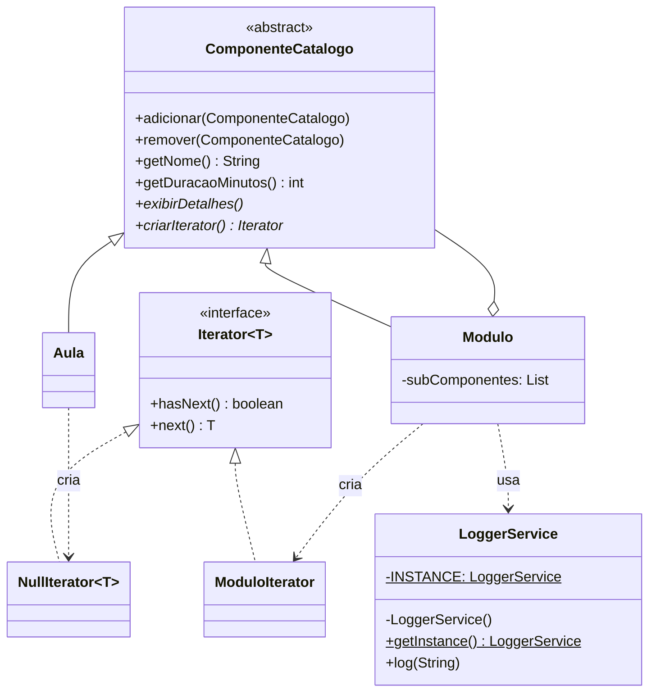

# TechLearn Solutions — Singleton, Composite e Iterator em Java

## 1. Título e Contexto

A **TechLearn Solutions** precisa gerenciar um catálogo de cursos hierárquico (Cursos → Módulos → Aulas), percorrê-lo de forma uniforme e registrar em log todas as operações relevantes. A solução integra três padrões de projeto do GoF:

| Padrão | Classes | Papel na arquitetura |
|---|---|---|
| **Singleton** | `techlearn.logging.LoggerService` | Ponto único e global de logging. A instância é criada uma única vez (inicialização *eager* em `private static final`), o construtor é `private` e o acesso ocorre via `getInstance()`. |
| **Composite** | `techlearn.composite.ComponenteCatalogo` (Component), `Aula` (Leaf), `Modulo` (Composite) | Representa a árvore do catálogo. `Modulo` agrega qualquer `ComponenteCatalogo` (aulas ou outros módulos) e calcula a duração total recursivamente; `Aula` é a folha com duração própria. |
| **Iterator** | `techlearn.iterator.Iterator` (interface), `ModuloIterator` (Concrete Iterator), `NullIterator` (Null Object) | Fornece percurso sobre os filhos de um componente sem expor a coleção interna (`List`). Folhas retornam um `NullIterator`, que nunca possui próximo elemento. |

```text
.
├── README.md
└── src/
    └── techlearn/
        ├── Main.java
        ├── logging/
        │   └── LoggerService.java
        ├── composite/
        │   ├── ComponenteCatalogo.java
        │   ├── Aula.java
        │   └── Modulo.java
        └── iterator/
            ├── Iterator.java
            ├── ModuloIterator.java
            └── NullIterator.java
```



## 2. Como Executar

Pré-requisito: JDK 8+ instalado (`javac` e `java` no `PATH`). A partir da raiz do projeto:

```bash
# Compilação (gera os .class em ./bin)
javac -encoding UTF-8 -d bin src/techlearn/logging/*.java src/techlearn/iterator/*.java src/techlearn/composite/*.java src/techlearn/Main.java

# Execução
java -cp bin techlearn.Main
```

> No Windows (PowerShell), para exibir os acentos corretamente, execute antes `[Console]::OutputEncoding = [Text.Encoding]::UTF8` e rode com `java -Dstdout.encoding=UTF-8 -cp bin techlearn.Main`.

## 3. Saída da Execução (Evidência)

Saída real capturada no terminal após executar `java -cp bin techlearn.Main` (JDK 21):

```text
[SISTEMA] Serviço de Logging Inicializado.
[2026-10-15 15:52:07] [LOG]: Iniciando montagem da estrutura de cursos...
[2026-10-15 15:52:07] [LOG]: Item 'Aula 1.1: Coesão e Acoplamento' adicionado ao módulo 'Módulo 1: Orientação a Objetos Avançada'.
[2026-10-15 15:52:07] [LOG]: Item 'Aula 1.2: Interfaces e Polimorfismo' adicionado ao módulo 'Módulo 1: Orientação a Objetos Avançada'.
[2026-10-15 15:52:07] [LOG]: Item 'Aula 2.1: Singleton na Prática' adicionado ao módulo 'Módulo 2: Padrões de Projeto (GoF)'.
[2026-10-15 15:52:07] [LOG]: Item 'Aula 2.2: Composite Hierárquico' adicionado ao módulo 'Módulo 2: Padrões de Projeto (GoF)'.
[2026-10-15 15:52:07] [LOG]: Item 'Aula 2.3: Iterator para Coleções' adicionado ao módulo 'Módulo 2: Padrões de Projeto (GoF)'.
[2026-10-15 15:52:07] [LOG]: Item 'Módulo 1: Orientação a Objetos Avançada' adicionado ao módulo 'Engenharia de Software Moderna'.
[2026-10-15 15:52:07] [LOG]: Item 'Módulo 2: Padrões de Projeto (GoF)' adicionado ao módulo 'Engenharia de Software Moderna'.
[2026-10-15 15:52:07] [LOG]: Estrutura montada com sucesso. Exibindo detalhes da ementa:

[Módulo/Curso]: Engenharia de Software Moderna | Duração Total: 225 min
--------------------------------------------------

[Módulo/Curso]: Módulo 1: Orientação a Objetos Avançada | Duração Total: 105 min
--------------------------------------------------
  - Aula: Aula 1.1: Coesão e Acoplamento (45 min)
  - Aula: Aula 1.2: Interfaces e Polimorfismo (60 min)

[Módulo/Curso]: Módulo 2: Padrões de Projeto (GoF) | Duração Total: 120 min
--------------------------------------------------
  - Aula: Aula 2.1: Singleton na Prática (30 min)
  - Aula: Aula 2.2: Composite Hierárquico (50 min)
  - Aula: Aula 2.3: Iterator para Coleções (40 min)

==================================================
Varredura do Curso Principal via Iterator:
==================================================
[2026-10-15 15:52:07] [LOG]: Navegando no Item Raiz: Módulo 1: Orientação a Objetos Avançada | Duração acumulada: 105 min
[2026-10-15 15:52:07] [LOG]: Navegando no Item Raiz: Módulo 2: Padrões de Projeto (GoF) | Duração acumulada: 120 min

==================================================
Desafio Passo 5: Filtro de Conteúdo Curto (<= 45 min):
==================================================
[2026-10-15 15:52:07] [LOG]: Iniciando filtragem de aulas individuais com duração <= 45 min...
[2026-10-15 15:52:07] [LOG]: [FILTRO <= 45 min] Aula 1.1: Coesão e Acoplamento (45 min)
[2026-10-15 15:52:07] [LOG]: [FILTRO <= 45 min] Aula 2.1: Singleton na Prática (30 min)
[2026-10-15 15:52:07] [LOG]: [FILTRO <= 45 min] Aula 2.3: Iterator para Coleções (40 min)
[2026-10-15 15:52:07] [LOG]: Execução da atividade finalizada.
```

Observações sobre a evidência:

- A mensagem `[SISTEMA] Serviço de Logging Inicializado.` aparece **uma única vez**, comprovando o Singleton, embora `LoggerService.getInstance()` seja chamado em vários pontos (`Main` e `Modulo`).
- A duração total do curso (225 min = 105 + 120) é calculada recursivamente pelo Composite.
- O filtro retornou exatamente as aulas com duração ≤ 45 min (45, 30 e 40 min) e ignorou as de 60 e 50 min.

## 4. Resolução do Passo 5 (Desafio de Extensão Prática)

### 4.1. O método `filtrarAulasCurtas`

```java
public static void filtrarAulasCurtas(ComponenteCatalogo componente, int limiteMinutos) {
    Iterator<ComponenteCatalogo> iterator = componente.criarIterator();

    if (!iterator.hasNext() && componente instanceof Aula) {
        if (componente.getDuracaoMinutos() <= limiteMinutos) {
            LoggerService.getInstance().log("[FILTRO <= " + limiteMinutos + " min] "
                    + componente.getNome() + " (" + componente.getDuracaoMinutos() + " min)");
        }
        return;
    }

    while (iterator.hasNext()) {
        ComponenteCatalogo subItem = iterator.next();
        filtrarAulasCurtas(subItem, limiteMinutos);
    }
}
```

Funcionamento:

1. Pede ao componente recebido (seja curso, módulo ou aula) o seu iterador via `criarIterator()`, sem saber qual implementação concreta vai receber.
2. **Caso base (folha):** se o iterador não tem elementos e o componente é uma `Aula`, verifica se a duração é `<= limiteMinutos`; se for, registra a aula no log via `LoggerService` (Singleton).
3. **Caso recursivo (composição):** se for um `Modulo`, percorre os filhos com `hasNext()`/`next()` e chama o método recursivamente em cada um. Assim a árvore é percorrida em profundidade (DFS), em qualquer nível de aninhamento.
4. O limite é um parâmetro (`45` na chamada do `Main`), então a mesma rotina serve para outros cortes (ex.: `filtrarAulasCurtas(curso, 30)`).

### 4.2. Pergunta: *"Como a separação entre a estrutura do Composite e a lógica de percurso do Iterator facilitou a adição dessa nova regra sem quebrar o código do cliente?"*

A nova regra de negócio ("listar apenas aulas de até 45 minutos") foi incluída **sem alterar nenhuma linha** de `ComponenteCatalogo`, `Aula`, `Modulo`, `ModuloIterator`, `NullIterator` ou `LoggerService`. Bastou acrescentar um método no cliente (`Main`). Isso só foi possível porque cada padrão cuida de uma preocupação diferente:

**1. Encapsulamento das coleções internas**
O `Modulo` guarda seus filhos em uma `List<ComponenteCatalogo>` privada. O filtro não acessa essa lista: ele só conhece o contrato `Iterator<ComponenteCatalogo>` (`hasNext()` / `next()`) devolvido por `criarIterator()`. Se amanhã a `List` virar um array, um `Set` ordenado ou uma consulta a banco de dados, basta trocar o iterador concreto, e o filtro continua funcionando sem recompilar a lógica do cliente. A estrutura (Composite) diz **o que** existe; o Iterator diz **como** percorrer. O cliente depende apenas da segunda abstração.

**2. `NullIterator` e o tratamento uniforme de folhas e composições**
Toda `Aula` devolve um `NullIterator`, cujo `hasNext()` sempre retorna `false`. Com isso, o cliente trata **qualquer** nó da árvore da mesma forma: pede o iterador e itera. Não há `null` para verificar, nem risco de `NullPointerException`, nem `UnsupportedOperationException` ao tentar navegar numa folha. É a aplicação do *Null Object Pattern*: o "nada a percorrer" é modelado por um objeto válido, e o laço `while (iterator.hasNext())` simplesmente não executa nas folhas. Esse é o mesmo princípio de transparência do Composite: o cliente trabalha com `ComponenteCatalogo` sem precisar distinguir, na maior parte do código, se está lidando com uma `Aula` ou um `Modulo`.

**3. SRP — Princípio da Responsabilidade Única**
- `Aula` / `Modulo`: representam os dados e a hierarquia do catálogo (e agregam a duração).
- `ModuloIterator` / `NullIterator`: sabem apenas como avançar sobre os filhos.
- `LoggerService`: sabe apenas formatar e emitir logs.
- `Main.filtrarAulasCurtas`: contém somente a **regra de negócio** do filtro.

Cada classe tem um único motivo para mudar. Uma mudança no critério do filtro (ex.: ≤ 30 min, ou só aulas com "Padrões" no nome) afeta apenas o método do cliente, nunca a estrutura nem o mecanismo de percurso.

**4. OCP — Princípio Aberto/Fechado**
O sistema ficou **aberto para extensão** (novas operações sobre o catálogo, como filtros, relatórios, somatórios ou exportações, podem ser escritas como novos clientes que usam `criarIterator()`) e **fechado para modificação** (as classes já testadas do Composite e do Iterator não precisaram ser editadas). Novos tipos de componente (ex.: `Exercicio`, `Avaliacao`) também podem ser adicionados herdando de `ComponenteCatalogo` e devolvendo o iterador adequado, sem quebrar o filtro existente.

**Conclusão:** a separação entre a *estrutura* (Composite) e o *percurso* (Iterator) transformou a adição de uma regra nova numa tarefa puramente aditiva. O cliente navega a árvore inteira por um contrato estável e polimórfico, e o `NullIterator` elimina casos especiais nas folhas. O código existente permanece intacto, o que reduz o risco de regressões e respeita SRP e OCP.
